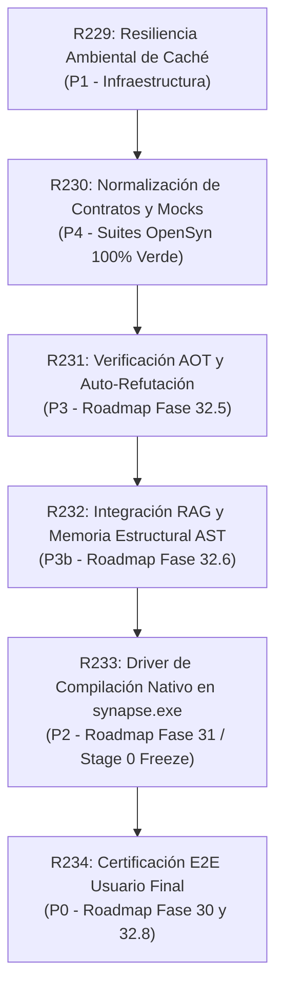

# Plan Maestro de Mejoras Arquitectónicas y Fase 32 (R229-R234)

**Fecha:** 2026-11-16  
**Ecosistema:** Synapse + Syquex + OpenSyn  
**Gobernanza:** Método de Trabajo Seguro (MTS) · Manuales 1 al 9 · Roadmap v8.1.0-industrial  

---

## 🎯 1. OBJETIVO GENERAL Y ALCANCE

Consolidar la infraestructura de compilación, erradicar fallos ambientales y de contratos, completar las subfases restantes de la **Fase 32 (Agente Autónomo OpenSyn)** con auto-refutación por contratos AST, independizar el pipeline de compilación de Python migrándolo al binario nativo, y culminar con la **certificación E2E de usuario final en máquina limpia**.

El plan se divide en **6 Micro-Entregables (MEs)** estrictamente ordenados y desacoplados:

---

## 🧱 2. DESGLOSE DETALLADO POR MICRO-ENTREGABLE

---

### 📦 R229: ME r229_cache_resiliencia (Jerarquía de Caché)
**Prioridad:** P1 (Bloqueante de entorno)  
**Objetivo:** Erradicar definitivamente los fallos `WinError 5 (Acceso denegado)` en sandboxes, runners CI y entornos multi-usuario en Windows/Linux/macOS al invocar el compilador.

#### Requisitos MTS
* **Requisito:** `Manual 1 §3.1` (pipeline de compilación compartido) y `Manual 9 §1` (caché del compilador bajo `~/.synapse/cache/`; build efímero).
* **Texto Normativo:** *"Toda caché del compilador ... se almacena bajo `~/.synapse/cache/` ... Los directorios de build del repositorio (`build/`, artefactos `*.o` en la raíz) son efímeros ... no deben usarse para caches persistentes."*
* **Implementación:**
  1. Modificar `_compilar_objeto_cacheado()` y helpers de caché en `pipeline.py`:
     - Nivel 1: `SYNAPSE_CACHE_DIR` explícito, si está definido.
     - Nivel 2: `~/.synapse/cache`, probando escritura real antes de usarlo.
     - Sin nivel persistente de fallback: si no es escribible, se avisa por stderr y se desactiva la caché persistente.
     - Compilación degradada en `build/obj/runtime_ephemeral` con memo en proceso; nunca caché persistente en workspace/temp.
  2. No modificar `nucleo/cache.syn`: el fallo reproducido está en el pipeline Python y el caché nativo no interviene en esa ruta.
  3. Prevenir `os.makedirs()` sin validación de permisos previa y no silenciar la degradación.
* **Oráculo de Verificación:**
  - `tests/unit/test_cache_fallback.py`: simula un entorno sin permisos de escritura en la caché y verifica que el pipeline compila sin `WinError 5`, no crea caché persistente en workspace/temp, emite aviso y usa objetos efímeros en `build/obj/runtime_ephemeral`.
* **Archivos Afectados:**
  - `pipeline.py` (`# cumple Manual 1 §3.1` y `# cumple Manual 9 §1`)
  - `tests/unit/test_cache_fallback.py` (nuevo oráculo)
  - `docs/alineacion/r229_cache_resiliencia.md` (expediente MTS)
  - `docs/verificacion_ME_r229_cache_resiliencia.md` (reporte de verificación)
* **Plan individual MTS:** `docs/plan_ME_r229_cache_resiliencia.md`

---

### 📦 R230: ME r230_opensyn_contratos_mocks (Normalización de Contratos y Mocks)
**Prioridad:** P4 (Calidad de Suites y Cero Deuda)  
**Objetivo:** Llevar la suite `tests/opensyn/` del 96.3% al **100% VERDE** (133/133 tests pasando), alineando los fixtures simulados a los contratos formales del lenguaje.

#### Requisitos MTS
* **Requisito:** `Manual 2 §5.1` (Contratos `requiere`/`garantiza`) y `Manual 7 §6.3` (Bucle de validación automática).
* **Texto Normativo:** *"Todas las precondiciones `requiere` deben evaluarse antes de la primera instrucción del cuerpo... el código generado que resulte vacío debe ser rechazado por el bucle de validación como una respuesta no válida."*
* **Implementación:**
  1. En `tests/opensyn/test_validation_loop_comportamiento.py` y `tests/opensyn/test_pipeline_multiagente_comportamiento.py`, los mocks que simulan turnos fallidos devuelven actualmente `""` (cadena vacía).
  2. Ajustar el mock para que devuelva código sintácticamente inválido pero no vacío (e.g. `"funcion principal() -> entero:\n    retornar error_sintaxis"`), permitiendo que el compilador real (`synapse check --no-emit`) sea quien detecte el fallo en lugar de que el contrato `requiere: longitud(codigo) > 0` aborte el proceso en runtime con `Assertion failed`.
  3. En `opensyn/validation_loop.syn`, asegurar que si el LLM retorna una cadena vacía, el bucle la intercepte como `ERR_RESPUESTA_VACIA` antes de invocar la validación por compilador, garantizando robustez ante respuestas nulas.
* **Oráculo de Verificación:**
  - `tests/opensyn/test_validation_loop_comportamiento.py` (4/4 PASSED).
  - `tests/opensyn/test_pipeline_multiagente_comportamiento.py` (1/1 PASSED).
  - Regresión completa de `tests/opensyn/` (133/133 PASSED).
* **Archivos Afectados:**
  - `opensyn/validation_loop.syn` (`// cumple Manual 7 §6.3`)
  - `tests/opensyn/test_validation_loop_comportamiento.py`
  - `tests/opensyn/test_pipeline_multiagente_comportamiento.py`

---

### 📦 R231: ME r231_verificacion_aot_fronteras (Auto-Refutación AOT por Contratos)
**Prioridad:** P3 (Capacidad Diferencial de OpenSyn / Subfase 32.5)  
**Objetivo:** Desarrollar el módulo nativo que sintetiza pruebas de casos límite automáticas basadas en las precondiciones del AST para refutar el código antes de entregarlo.

#### Requisitos MTS
* **Requisito:** `ROADMAP.md` Fase 32.5 (Verificación AOT con auto-refutación) y `Manual 7 §6.3`.
* **Texto Normativo:** *"Expandir el bucle de validación actual (`synapse check --no-emit`) con auto-refutación: generar casos límite, compilarlos y ejecutarlos para verificar que el código es robusto... Compilación de caso límite: < 1 s."*
* **Implementación:**
  1. Completar `opensyn/verificacion_aot.syn`:
     - Inspección del AST (`SemNodo[]`): identificar funciones exportadas y sus cláusulas `requiere`.
     - Síntesis de `CasoLimite`:
       * Para enteros con `x > N` o `x <= M`: sintetizar fronteras $N-1, N, N+1, M, M+1$.
       * Para textos: cadena vacía `""`, un carácter `"a"`, cadena larga.
       * Para punteros/referencias: valor nulo `nulo`.
     - Inyección de arnés de prueba temporal en memoria.
  2. Conectar con `runtime/core/proceso.c` (`proceso_ejecutar_async` con timeout de 3 segundos por caso).
  3. Si un caso límite genera violación de contrato no esperada o crash (`rc != 0`), retroalimentar los errores al prompt del `Fixer` del pipeline multi-agente.
* **Oráculo de Verificación:**
  - `tests/opensyn/test_verificacion_aot_fronteras.py`: Prueba E2E donde OpenSyn recibe una función con un bug de off-by-one en un índice, el módulo de auto-refutación genera el caso de frontera, detecta el fallo y el bucle entrega la función corregida.
* **Archivos Afectados:**
  - `opensyn/verificacion_aot.syn` (`// cumple Manual 7 §6.3`)
  - `opensyn/pipeline_multiagente.syn` (`// cumple Manual 7 §6.3`)
  - `tests/opensyn/test_verificacion_aot_fronteras.py` (nuevo)

---

### 📦 R232: ME r232_rag_memoria_estructural (Integración RAG con Memoria Estructural)
**Prioridad:** P3b (Inteligencia de Contexto / Subfase 32.6)  
**Objetivo:** Integrar la memoria persistente cifrada (R212) y el análisis de impacto determinista (R211/R217) directamente en el generador de prompts del agente.

#### Requisitos MTS
* **Requisito:** `ROADMAP.md` Fase 32.6 y `Manual 7 §2.3` (Inyección de contexto y reglas).
* **Texto Normativo:** *"Integrar la memoria persistente y el análisis de impacto determinista en el pipeline RAG, para que el prompt incluya patrones exitosos, fallos previos y análisis de impacto... La latencia total del ciclo es < 30 s."*
* **Implementación:**
  1. En `opensyn/memoria_persistente_cifrada.syn`, extender la indexación de RAM para incluir la firma estructural del AST (`hash_firma_ast` derivado de tipos de parámetros y retornos).
  2. En `opensyn/router.syn` y `opensyn/pipeline_multiagente.syn`:
     - `construir_prompt_coder(contexto)`: Inyectar el bloque determinista de `AnalisisImpacto` generado por `architect_det.syn`.
     - Inyectar hasta 3 `PatronAprendido` y 2 `MemoriaNegativa` relevantes desde la base cifrada.
     - Respetar la ventana máxima de contexto configurada en `~/.opensyn/config.toml`.
* **Oráculo de Verificación:**
  - `tests/integration/test_rag_pipeline_32.py`: Verifica que el prompt ensamblado incluye las advertencias de impacto del AST y que se recuperan patrones previamente guardados en la base cifrada.
* **Archivos Afectados:**
  - `opensyn/router.syn` (`// cumple Manual 7 §2.3`)
  - `opensyn/pipeline_multiagente.syn` (`// cumple Manual 7 §2.3`)
  - `opensyn/memoria_persistente_cifrada.syn` (`// cumple Manual 7 §7.3`)
  - `tests/integration/test_rag_pipeline_32.py` (nuevo)

---

### 📦 R233: ME r233_compilador_puro_nativo (Driver de Compilación Nativo en synapse.exe)
**Prioridad:** P2 (Independencia Arquitectónica / Fase 31)  
**Objetivo:** Trasladar la invocación de GCC, la gestión de la caché y el enlazado final directamente a `synapse.exe`, relegando Python exclusivamente a Stage 0 (semilla inmutable de arranque).

#### Requisitos MTS
* **Requisito:** `Manual 1 §3.1` (Arquitectura del compilador autoalojado) y `Manual 8 §4` (CLI nativo unificado).
* **Texto Normativo:** *"El compilador de Synapse debe ser completamente autoalojado... La invocación estándar de `synapse build` o `synapse check` no debe requerir un intérprete externo de Python en el entorno de producción."*
* **Implementación:**
  1. Portar la lógica de orquestación de `pipeline.py` (`_compilar_objeto_cacheado`, `ejecutar_enlace`) a `nucleo/principal.syn` y `nucleo/resolvedor_axon.syn`.
  2. Implementar la invocación directa de subprocesos usando `runtime/core/proceso.c`.
  3. Incrustar las cabeceras mínimas necesarias (`ffi_marshaling.h`, `embedded_libs.h`) como cadenas estáticas en el binario nativo.
* **Oráculo de Verificación:**
  - `tests/auditoria/test_oraculo_compilador_puro_nativo.py`: Compila un programa `.syn` invocando directamente `synapse.exe build programa.syn -o programa.exe` sin Python en el PATH.
* **Archivos Afectados:**
  - `nucleo/principal.syn` (`// cumple Manual 8 §4`)
  - `nucleo/generator.syn` (`// cumple Manual 1 §3.1`)
  - `nucleo/embedded_libs.h`
  - `tests/auditoria/test_oraculo_compilador_puro_nativo.py` (nuevo)

---

### 📦 R234: ME r234_certificacion_usuario_final (Certificación E2E en Máquina Limpia)
**Prioridad:** P0 (Criterio de Aceptación Final / Roadmap Fases 30 y 32.8)  
**Objetivo:** Validar la experiencia de usuario final de punta a punta en un entorno virgen (sin Python, GCC ni dependencias previas): instalación, compilación en < 1 s, autocompletado en VS Code con LSP nativo y asistencia interactiva de OpenSyn con modelo instruct local.

#### Requisitos MTS
* **Requisito:** `Manual 9 §7` (pruebas obligatorias de instalación limpia) y `Manual 7 §7.3` (operación local/privacidad de OpenSyn).
* **Texto Normativo:** *"| Instalación en Windows (limpiamente) | Ejecutar instalador en máquina virtual Windows limpia | Instalación exitosa, PATH configurado, `synapse --version` funciona. |"*
* **Implementación:**
  1. Desarrollar arnés automatizado `tests/e2e/test_smoke_usuario_final.py`:
     - Ejecuta instalación desatendida del instalador Windows / script Unix.
     - Valida `synapse build` y ejecución de `01_basico.syn` y `01_basico.syq`.
     - Valida respuesta del LSP (`synapse_lsp`) ante `initialize` y `textDocument/completion`.
     - Valida sesión de chat en OpenSyn (`synapse opensyn`) consultando una refactorización de código con el modelo instruct local.
  2. Redactar el reporte de cierre formal del ecosistema: `docs/reportes/FASE_32_CERTIFICACION.md`.
* **Oráculo de Verificación:**
  - `tests/e2e/test_smoke_usuario_final.py`: Suite E2E completa de humo post-instalación (4/4 PASSED).
* **Archivos Afectados:**
  - `tests/e2e/test_smoke_usuario_final.py` (nuevo oráculo)
  - `docs/reportes/FASE_32_CERTIFICACION.md` (reporte final)
  - `docs/plan_ME_r234_certificacion_usuario_final.md` (plan MTS)

